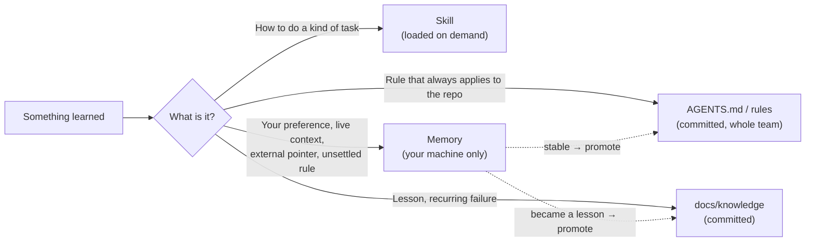
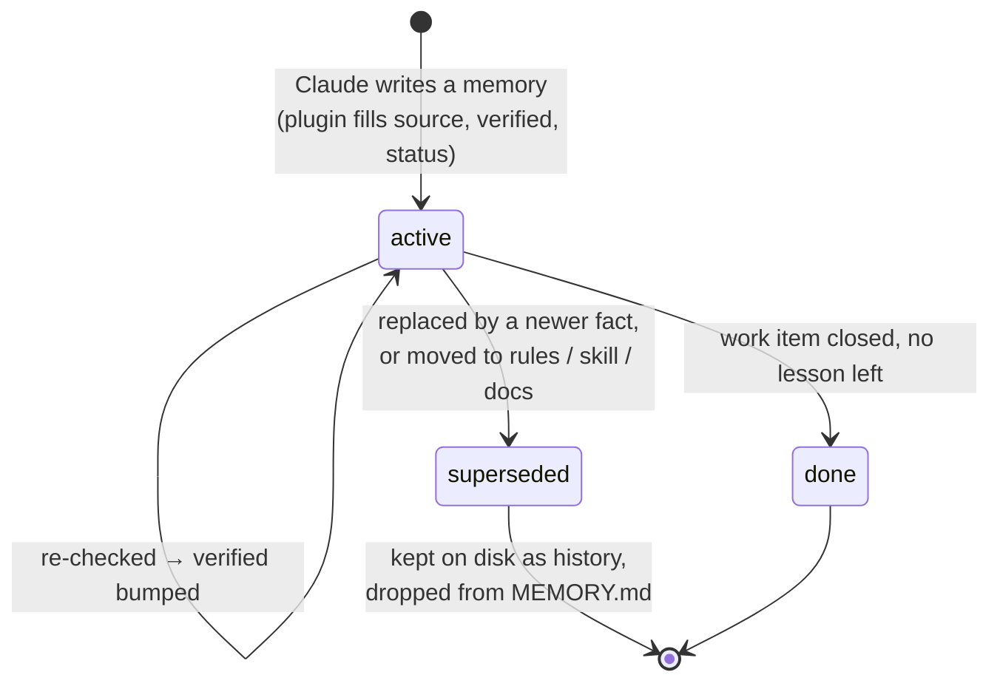
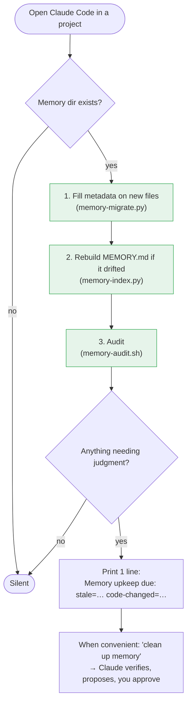

# memory-hygiene

[Tiếng Việt](README.md) | **English**

A Claude Code plugin that keeps auto-memory **small, current and trustworthy**, in every project.

Claude Code already writes memories on its own (`~/.claude/projects/<project>/memory/`).
Left alone, they pile up: stale facts, duplicates, paths that no longer exist, and an index
that is loaded into *every* session. This plugin keeps that in check with almost no effort from you.

## Quick start

```text
/plugin marketplace add nhim411/claude-memory-hygiene
/plugin install memory-hygiene@nhim411-memory-hygiene
```

Restart Claude Code, then in each project say once:

> migrate memory

That's it. From then on:

| You | The plugin |
|---|---|
| work normally | fixes the index and missing metadata at every session start, silently |
| see `Memory upkeep due: …` | nothing required; act on it when you have a minute |
| say **"clean up memory"** / **"dọn memory"** | audits, re-checks stale facts, proposes changes, rebuilds the index |
| say **"remember …"** | stores it with the right type, source and date |

## Where memory lives

Claude Code stores memory **per project**, outside the repo, in your home directory:

```text
~/.claude/projects/
└── -home-you-workspace-myapp/          ← project path with "/" and "." turned into "-"
    └── memory/
        ├── MEMORY.md                   ← INDEX: loaded into EVERY session (keep it small!)
        ├── feedback-test-on-staging.md ← one memory per file, with frontmatter
        ├── reference-stg-access.md
        └── project-epic-123.md
```

- Memory exists only on your machine. It is not committed and not shared with the team.
- `MEMORY.md` is a table of contents: each line has a title, a link to the file and a one-line hook.
  Claude reads the index every session and opens a file only when it needs it.
- The plugin installs under `~/.claude/plugins/` (shared by all projects) and finds the memory dir from the current directory.

Memory is only **one of several homes** for knowledge. Each piece should end up in its most durable home:



## How it works

### Life of a memory



Each memory file carries a little metadata:

```yaml
metadata:
  type: user | feedback | project | reference
  source: user | agent      # what you said is never rewritten by Claude on its own
  verified: 2026-10-29      # last check against the code / tracker
  status: active | superseded | done
```

Only `active` memories appear in `MEMORY.md`.

### At every session start



Steps 1–3 (green) are automatic and deterministic. The plugin **never edits what a memory says**;
that needs judgment, so Claude proposes and you approve.

### What the audit checks

| Signal | Meaning | Action |
|---|---|---|
| **stale** | not verified for 45 days | re-check, bump `verified` |
| **code changed** | a cited file got commits after `verified` (git) | read the diff, fix or confirm |
| **broken path** | a cited repo path is gone | fix the path |
| **over budget** | index > 8 KB, > 45 entries, or a line > 200 chars | shorten, promote, supersede |
| **promote candidates** | your rule stable > 30 days | move it to project rules |

Real example: a memory said "Dockerfile optimisation pending" and cited `backend/docker/Production.Dockerfile`.
That file got 2 commits after `verified`, so the audit raised **code changed**. Claude checked, found the PR
had merged, and updated the memory. Without this, the next session would still believe the work was pending.

## Design: why it is efficient

1. **Small index, loaded always.** Only what matters in *every* session goes in `MEMORY.md`;
   the rest is opened on demand.
2. **Memory is a staging area.** Stable rules move to `AGENTS.md` / project rules, techniques
   to skills, lessons to docs. Memory keeps only what has no better home yet.
3. **Supersede, don't overwrite.** Old facts keep their history; what you said beats what
   Claude inferred.
4. **Automate the deterministic, nudge for judgment.** Scripts never change a fact's meaning.
5. **Validity from git, not from a graph.** Tens of files do not need a knowledge graph;
   "cited code changed since verified" is the exact staleness signal.

Full guideline: [`docs/memory-system.md`](docs/memory-system.md).

## Settings (optional env vars)

| Variable | Default |
|---|---|
| `MEMORY_INDEX_MAX_BYTES` | 8000 |
| `MEMORY_INDEX_MAX_ENTRIES` | 45 |
| `MEMORY_INDEX_MAX_LINE` | 200 |
| `MEMORY_HYGIENE_DIR` | memory dir derived from the current directory |

## Manual commands

```bash
python3 scripts/memory-migrate.py [memory_dir]                 # add metadata (idempotent)
python3 scripts/memory-index.py   [memory_dir] [--check]       # rebuild / check MEMORY.md
bash    scripts/memory-audit.sh   [memory_dir] [repo] [days]   # full report, changes nothing
```

Requires bash, python3, git. CI runs `tests/run.sh` on Linux and macOS.

## License

MIT
