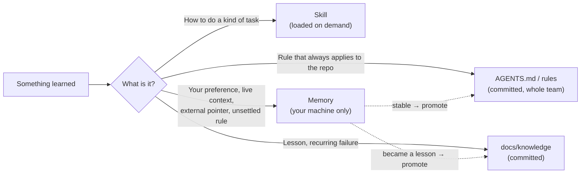
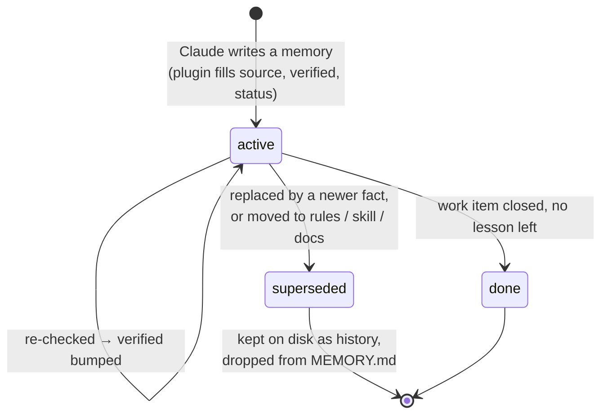
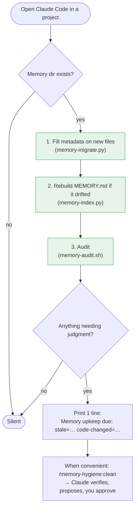

# 🧠 memory-hygiene

[Tiếng Việt](README.md) | **English**

[](https://github.com/nhim411/claude-memory-hygiene/actions/workflows/test.yml)


### Claude remembering more is not better. Remembering right is.

Claude Code's auto-memory only ever grows. After a few months every session loads dozens of
stale, duplicated notes pointing at files that no longer exist, and Claude may quietly act on a
"fact" that stopped being true last month.

**memory-hygiene** keeps memory **small, current and trustworthy**: two commands to install, zero config.

## ✨ Real results on a live project

| | Before | After |
|---|---|---|
| Index entries (loaded into **every** session) | 60 | **40** |
| Index size | 11.8 KB | **7.0 KB** (about 1.2k fewer tokens per session) |
| Memories with source + verified date | 0 | **100%** |
| Wrong "facts" caught | — | a renamed route, a merged PR still noted as "pending"… |
| Added session-start time | — | **~0.07 s** (cached) |

## 🚀 Highlights

- **🔍 Knows when a memory went wrong.** A file the memory cites got commits after it was last
  verified? You are told. That is the most precise signal that a note may be stale.
- **🧹 Auto-fixes the certain, asks about the rest.** Index and metadata are repaired every session.
  Content changes are proposed by Claude with evidence, and you approve.
- **🛡️ What you said stays as you said it.** `source: user` memories are never rewritten by Claude
  on its own.
- **📉 The index stays small.** Size and line budgets, plus a report of memories nobody opened in 60 days.
- **⬆️ Stable rules graduate to team rules.** `/memory-hygiene:promote` drafts project rules from
  what you keep repeating, so the whole team benefits.
- **🕰️ History is kept.** Old facts are marked `superseded`, never deleted.
- **⚡ Lightweight.** bash + python3 + git. No database, no embeddings, no network.
  CI on Linux and macOS.

```text
$ claude          # start a session as usual
Memory upkeep due: stale=1 code-changed=1 … Run /memory-hygiene:clean when the current task allows.

> /memory-hygiene:clean
| File              | Memory says                    | Code now                        | Action |
| ci-pipeline.md    | "Dockerfile tuning pending"    | PR 2857 merged 2026-10-15       | Fix    |
| cdp-click.md      | route /features/[a]/[b]        | /features/[...featurePath]      | Fix    |
Approve and I will apply the changes and rebuild the index.
```

## ⏱️ Install in 30 seconds

```text
/plugin marketplace add nhim411/claude-memory-hygiene
/plugin install memory-hygiene@nhim411-memory-hygiene
```

Restart Claude Code. **That's it**: on the first session in each project the plugin adds metadata
to your existing memories and rebuilds the index. From then on:

| You | The plugin |
|---|---|
| work normally | fixes the index and missing metadata at every session start, silently |
| see `Memory upkeep due: …` | nothing required; act on it when you have a minute |
| type **`/memory-hygiene:clean`** (or say "clean up memory") | audits, re-checks stale facts, proposes changes, rebuilds the index |
| type **`/memory-hygiene:audit`** | report only, changes nothing |
| type **`/memory-hygiene:promote`** | drafts stable rules into project rules |
| say **"remember …"** | stores it with the right type, source and date |

## Where memory lives

Claude Code stores memory **per project**, outside the repo, in your home directory:

```text
~/.claude/projects/
└── -home-you-workspace-myapp/          ← project path with "/" and "." turned into "-"
    └── memory/
        ├── MEMORY.md                   ← INDEX: loaded into EVERY session (keep it small!)
        ├── feedback-test-on-staging.md ← one memory per file, with frontmatter
        ├── reference-stg-access.md
        └── project-epic-123.md
```

- Memory exists only on your machine. It is not committed and not shared with the team.
- `MEMORY.md` is a table of contents: each line has a title, a link to the file and a one-line hook.
  Claude reads the index every session and opens a file only when it needs it.
- The plugin installs under `~/.claude/plugins/` (shared by all projects) and finds the memory dir from the current directory.

Memory is only **one of several homes** for knowledge. Each piece should end up in its most durable home:



## How it works

### Life of a memory



Each memory file carries a little metadata:

```yaml
metadata:
  type: user | feedback | project | reference
  source: user | agent      # what you said is never rewritten by Claude on its own
  verified: 2026-10-29      # last check against the code / tracker
  status: active | superseded | done
```

Only `active` memories appear in `MEMORY.md`.

### At every session start



The audit result is cached until memory, git HEAD or the date changes, so session start is near-instant.
Each time Claude opens a memory file, a hook logs it to `memory/.usage.log`, so the plugin knows which memories are actually used.

Steps 1–3 (green) are automatic and deterministic. The plugin **never edits what a memory says**;
that needs judgment, so Claude proposes and you approve.

### What the audit checks

| Signal | Meaning | Action |
|---|---|---|
| **stale** | not verified for 45 days | re-check, bump `verified` |
| **code changed** | a cited file got commits after `verified` (git) | read the diff, fix or confirm |
| **broken path** | a cited repo path is gone | fix the path |
| **over budget** | index > 8 KB, > 45 entries, or a line > 200 chars | shorten, promote, supersede |
| **promote candidates** | your rule stable > 30 days | move it to project rules |
| **unused** | not opened for 60 days (tracked by a hook) | drop from index or supersede |
| **related pairs** | two memories share many words, may duplicate | read both, merge if they say the same |

The last three show only in the `/memory-hygiene:audit` report; they do not trigger the session nudge.
`unused` starts reporting once 60 days of usage have been tracked.

Real example: a memory said "Dockerfile optimisation pending" and cited `backend/docker/Production.Dockerfile`.
That file got 2 commits after `verified`, so the audit raised **code changed**. Claude checked, found the PR
had merged, and updated the memory. Without this, the next session would still believe the work was pending.

## Design: why it is efficient

1. **Small index, loaded always.** Only what matters in *every* session goes in `MEMORY.md`;
   the rest is opened on demand.
2. **Memory is a staging area.** Stable rules move to `AGENTS.md` / project rules, techniques
   to skills, lessons to docs. Memory keeps only what has no better home yet.
3. **Supersede, don't overwrite.** Old facts keep their history; what you said beats what
   Claude inferred.
4. **Automate the deterministic, nudge for judgment.** Scripts never change a fact's meaning.
5. **Validity from git, not from a graph.** Tens of files do not need a knowledge graph;
   "cited code changed since verified" is the exact staleness signal.

Full guideline: [`docs/memory-system.md`](docs/memory-system.md).

## Settings (optional env vars)

| Variable | Default |
|---|---|
| `MEMORY_INDEX_MAX_BYTES` | 8000 |
| `MEMORY_INDEX_MAX_ENTRIES` | 45 |
| `MEMORY_INDEX_MAX_LINE` | 200 |
| `MEMORY_UNUSED_DAYS` | 60 |
| `MEMORY_DUP_THRESHOLD` | 0.4 |
| `MEMORY_HYGIENE_NO_CACHE` | (set to anything to disable the cache) |
| `MEMORY_HYGIENE_DIR` | memory dir derived from the current directory |

## Manual commands

```bash
python3 scripts/memory-migrate.py [memory_dir]                 # add metadata (idempotent)
python3 scripts/memory-index.py   [memory_dir] [--check]       # rebuild / check MEMORY.md
bash    scripts/memory-audit.sh   [memory_dir] [repo] [days]   # full report, changes nothing
```

Requires bash, python3, git. CI runs `tests/run.sh` on Linux and macOS.

## License

MIT
