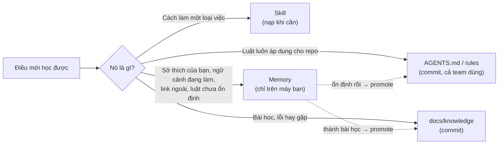
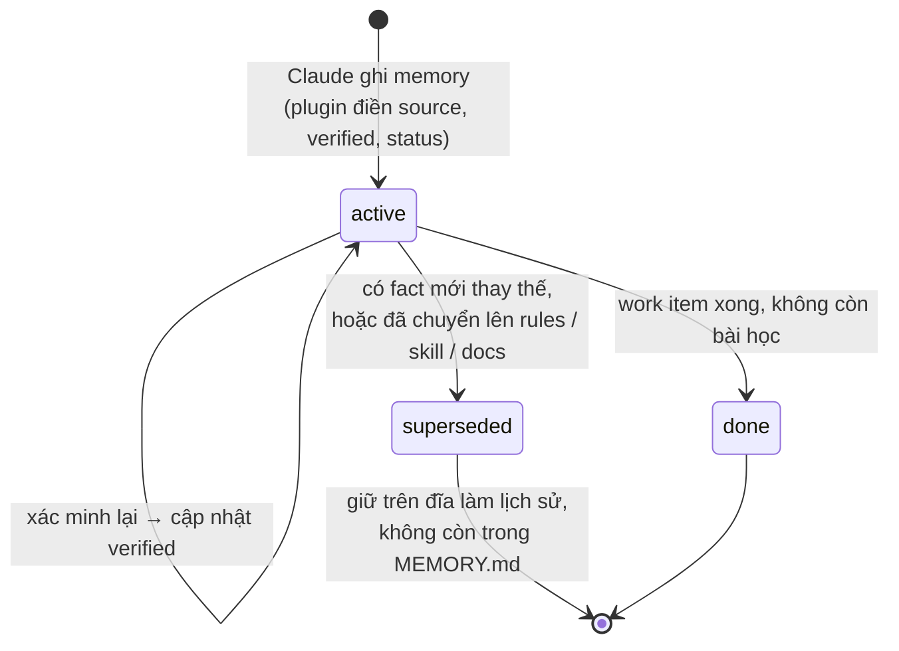
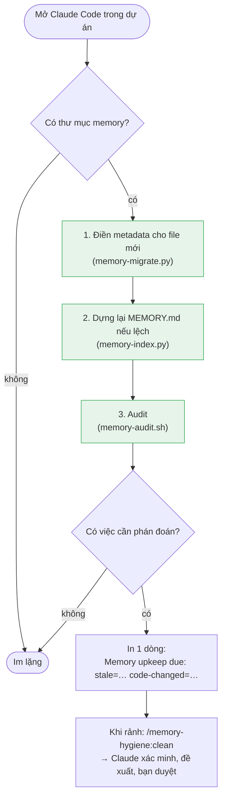

# 🧠 memory-hygiene

**Tiếng Việt** | [English](README.en.md)

[](https://github.com/nhim411/claude-memory-hygiene/actions/workflows/test.yml)


### Claude nhớ nhiều chưa chắc đã tốt. Nhớ đúng mới tốt.

Auto-memory của Claude Code chỉ ghi thêm, không bao giờ tự dọn. Sau vài tháng, mỗi phiên làm việc
phải nạp hàng chục ghi chú cũ, trùng lặp, trỏ tới file đã bị xoá. Claude có thể làm theo một
"sự thật" đã sai từ tháng trước mà không ai hay.

**memory-hygiene** giữ memory **gọn, đúng và đáng tin**: cài 2 lệnh, không phải cấu hình gì.

## ✨ Kết quả thật trên một dự án đang chạy

| | Trước | Sau |
|---|---|---|
| Mục trong index (nạp vào **mọi** phiên) | 60 | **40** |
| Kích thước index | 11.8 KB | **7.0 KB** (bớt khoảng 1.2k token mỗi phiên) |
| Memory có nguồn + ngày xác minh | 0 | **100%** |
| "Sự thật" đã sai được phát hiện | — | route đã đổi, PR đã merge mà memory vẫn ghi "đang chờ"… |
| Thời gian thêm vào lúc mở phiên | — | **~0.07 giây** (có cache) |

## 🚀 Tính năng nổi bật

- **🔍 Biết khi nào memory đã sai.** Một file mà memory nhắc tới có commit mới sau lần xác minh?
  Plugin báo ngay. Đây là tín hiệu chính xác nhất rằng một ghi nhớ có thể đã lỗi thời.
- **🧹 Tự dọn phần chắc chắn, hỏi bạn phần cần phán đoán.** Index và metadata được sửa tự động mỗi phiên.
  Nội dung thì Claude đề xuất kèm bằng chứng, bạn duyệt.
- **🛡️ Điều bạn dặn thì không ai được tự sửa.** Memory ghi `source: user` có quyền cao nhất:
  Claude không bao giờ tự ý thay đổi.
- **📉 Index luôn nhỏ.** Có giới hạn kích thước, độ dài dòng, và báo memory không ai đọc suốt 60 ngày.
- **⬆️ Luật ổn định lên rules của team.** `/memory-hygiene:promote` soạn sẵn rule từ những gì bạn
  đã dặn đi dặn lại, để cả team cùng dùng.
- **🕰️ Không mất lịch sử.** Thông tin cũ được đánh dấu `superseded`, không bị xoá.
- **⚡ Nhẹ, chạy mọi nơi.** Chỉ bash + Python 3 + git. Không database, không embedding, không gọi mạng.
  Chạy trên Linux, macOS và Windows (Git Bash có sẵn khi cài Claude Code). CI test cả 3.

```text
$ claude          # mở phiên như bình thường
Memory upkeep due: stale=1 code-changed=1 … Run /memory-hygiene:clean when the current task allows.

> /memory-hygiene:clean
| File              | Memory nói                     | Code hiện tại                   | Đề xuất |
| ci-pipeline.md    | "tối ưu Dockerfile đang chờ"   | PR 2857 đã merge 2026-10-15     | Fix     |
| cdp-click.md      | route /features/[a]/[b]        | /features/[...featurePath]      | Fix     |
Đồng ý thì tôi áp dụng và dựng lại index.
```

## ⏱️ Cài đặt trong 30 giây

```text
/plugin marketplace add nhim411/claude-memory-hygiene
/plugin install memory-hygiene@nhim411-memory-hygiene
```

Khởi động lại Claude Code. **Vậy là xong**: lần mở phiên đầu tiên ở mỗi dự án, plugin tự thêm metadata
cho memory sẵn có và dựng lại index. Từ đó về sau:

| Bạn | Plugin |
|---|---|
| làm việc bình thường | mỗi lần mở phiên tự sửa index và điền metadata còn thiếu, không làm phiền |
| thấy dòng `Memory upkeep due: …` | không bắt buộc làm gì; rảnh thì xử lý |
| gõ **`/memory-hygiene:clean`** (hoặc nói "dọn memory") | kiểm tra, xác minh lại thông tin cũ, đề xuất thay đổi, dựng lại index |
| gõ **`/memory-hygiene:audit`** | chỉ xem báo cáo, không sửa gì |
| gõ **`/memory-hygiene:promote`** | soạn nháp để chuyển luật ổn định lên rules của dự án |
| nói **"nhớ giúp …"** / **"remember …"** | lưu lại với đúng loại, nguồn và ngày |

## Memory được lưu ở đâu

Claude Code lưu memory **theo từng dự án**, bên ngoài repo, trong thư mục home của bạn:

```text
~/.claude/projects/
└── -home-you-workspace-myapp/          ← đường dẫn dự án, "/" và "." đổi thành "-"
    └── memory/
        ├── MEMORY.md                   ← INDEX: nạp vào MỌI phiên (giữ nhỏ!)
        ├── feedback-test-on-staging.md ← mỗi memory là 1 file, có frontmatter
        ├── reference-stg-access.md
        └── project-epic-123.md
```

- Memory chỉ nằm trên máy bạn, không commit, không chia sẻ cho team.
- `MEMORY.md` là mục lục: mỗi dòng gồm tiêu đề, link tới file và một câu tóm tắt.
  Claude đọc mục lục ở mỗi phiên, còn nội dung file chỉ mở khi cần.
- Plugin cài vào `~/.claude/plugins/` (dùng chung mọi dự án) và tự tìm thư mục memory theo thư mục đang mở.

Memory chỉ là **một trong nhiều nơi** lưu kiến thức. Kiến thức nào cũng nên về chỗ bền nhất của nó:



## Cách hoạt động

### Vòng đời một memory



Mỗi file memory có một ít metadata:

```yaml
metadata:
  type: user | feedback | project | reference
  source: user | agent      # điều bạn nói thì Claude không tự ý sửa
  verified: 2026-10-29      # lần cuối đối chiếu với code / tracker
  status: active | superseded | done
```

Chỉ memory `active` có mặt trong `MEMORY.md`.

### Mỗi lần mở phiên



Kết quả audit được cache cho tới khi memory, git HEAD hoặc ngày thay đổi, nên mở phiên gần như tức thì.
Ngoài ra, mỗi lần Claude mở một file memory, hook ghi lại vào `memory/.usage.log` để biết memory nào thật sự được dùng.

Bước 1–3 (màu xanh) chạy tự động và luôn cho cùng một kết quả. Plugin **không bao giờ tự sửa nội dung**
của memory: phần đó cần phán đoán nên để Claude đề xuất và bạn duyệt.

### Audit kiểm tra gì

| Dấu hiệu | Nghĩa là | Xử lý |
|---|---|---|
| **stale** | quá 45 ngày chưa xác minh | đối chiếu lại, cập nhật `verified` |
| **code changed** | file mà memory nhắc tới có commit sau ngày `verified` (git) | đọc lại diff, sửa hoặc xác nhận |
| **broken path** | đường dẫn trong repo không còn | sửa đường dẫn |
| **over budget** | index > 8 KB, > 45 mục, hoặc dòng > 200 ký tự | rút gọn, promote, supersede |
| **promote candidates** | luật của bạn ổn định > 30 ngày | chuyển lên rules của dự án |
| **unused** | 60 ngày không được mở (theo dõi bằng hook) | bỏ khỏi index hoặc supersede |
| **related pairs** | hai memory có nhiều từ chung, có thể trùng | đọc cả hai, gộp nếu nói cùng một điều |

Ba dòng cuối chỉ hiện trong báo cáo `/memory-hygiene:audit`, không làm hiện dòng nhắc đầu phiên.
`unused` chỉ bắt đầu báo sau khi đã theo dõi đủ 60 ngày.

Ví dụ thật: một memory nói "tối ưu Dockerfile đang chờ làm" và nhắc tới `backend/docker/Production.Dockerfile`.
File đó có 2 commit sau ngày `verified`, nên audit báo **code changed**. Claude kiểm tra và thấy PR đã merge,
rồi cập nhật memory. Không có cơ chế này, phiên sau vẫn tin rằng việc còn đang chờ.

## Thiết kế: vì sao hiệu quả

1. **Index nhỏ, luôn được nạp.** Chỉ những gì cần ở *mọi* phiên mới nằm trong `MEMORY.md`;
   phần còn lại chỉ mở khi cần.
2. **Memory là chỗ tạm.** Luật ổn định chuyển lên `AGENTS.md` / rules, kỹ thuật chuyển vào skill,
   bài học chuyển vào docs. Memory chỉ giữ những gì chưa có chỗ tốt hơn.
3. **Thay thế, không ghi đè.** Thông tin cũ được giữ làm lịch sử; điều bạn nói thắng điều Claude suy luận.
4. **Tự động phần chắc chắn, nhắc phần cần phán đoán.** Script không bao giờ đổi ý nghĩa của một memory.
5. **Kiểm tra độ cũ bằng git, không cần knowledge graph.** Vài chục file không cần graph;
   "code được nhắc tới đã đổi sau ngày xác minh" là tín hiệu chính xác nhất.

Hướng dẫn đầy đủ (tiếng Anh): [`docs/memory-system.md`](docs/memory-system.md).

## Cấu hình (biến môi trường, không bắt buộc)

| Biến | Mặc định |
|---|---|
| `MEMORY_INDEX_MAX_BYTES` | 8000 |
| `MEMORY_INDEX_MAX_ENTRIES` | 45 |
| `MEMORY_INDEX_MAX_LINE` | 200 |
| `MEMORY_UNUSED_DAYS` | 60 |
| `MEMORY_DUP_THRESHOLD` | 0.4 |
| `MEMORY_HYGIENE_NO_CACHE` | (đặt bất kỳ giá trị nào để tắt cache) |
| `MEMORY_HYGIENE_DIR` | thư mục memory suy ra từ thư mục đang mở |

## Lệnh chạy tay

```bash
python3 scripts/memory-migrate.py [memory_dir]                 # thêm metadata (chạy lại nhiều lần không sao)
python3 scripts/memory-index.py   [memory_dir] [--check]       # dựng lại / kiểm tra MEMORY.md
bash    scripts/memory-audit.sh   [memory_dir] [repo] [days]   # báo cáo đầy đủ, không sửa gì
```

Cần bash, Python 3 (`python3`, `python` hoặc `py`), git. Trên Windows dùng Git Bash, thứ Claude Code vốn đã yêu cầu. CI chạy `tests/run.sh` trên Linux, macOS và Windows.

## Giấy phép

MIT
